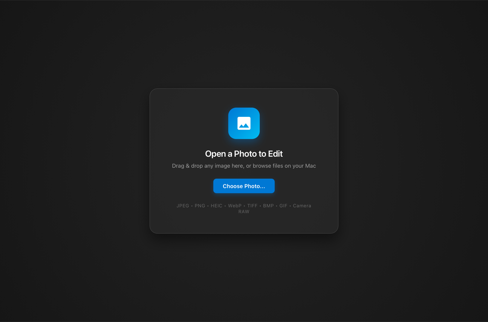

<div align="center">

  

  <h1>Photos Editor for macOS</h1>

  <p><strong>A high-performance, standalone native macOS desktop image editor.</strong><br />
  Re-engineered from the Windows 11 Photos application into a lightweight, native Cocoa/AppKit application powered by Swift, WebKit, WebGL2, and WebAssembly.</p>

  <p>
    <a href="https://github.com/imgolamrabbani/photos-editor-mac/releases"></a>
    <a href="https://github.com/imgolamrabbani/photos-editor-mac/releases"></a>
    <a href="https://github.com/imgolamrabbani/photos-editor-mac"></a>
    <a href="https://github.com/imgolamrabbani/photos-editor-mac/releases"></a>
    <a href="https://github.com/imgolamrabbani/photos-editor-mac"></a>
    <a href="https://github.com/imgolamrabbani/photos-editor-mac/releases/tag/v1.0.0"></a>
  </p>

  <p>
    <a href="#key-features">Key Features</a> &bull;
    <a href="#size-comparison">Efficiency Story</a> &bull;
    <a href="#installation">Installation</a> &bull;
    <a href="#keyboard-shortcuts">Shortcuts</a> &bull;
    <a href="#technical-architecture">Architecture</a> &bull;
    <a href="#building-from-source">Building</a>
  </p>

  <br />

  

</div>

---

## Executive Summary

The official Windows 11 Photos application integrates a sophisticated image editing pipeline featuring WebGL-accelerated color grading, canvas transformations, vector markup, and WebAssembly patch synthesis. However, on Windows, this editor is bundled inside a 1.1 GB container bloated with .NET runtimes, cloud synchronization modules, and DirectML telemetry.

**Photos Editor for macOS** extracts and reconstructs the core image manipulation pipeline as a native macOS application. Packaged in a compact 11 MB distribution (3.1 MB compressed DMG), it delivers the full desktop editing suite with instantaneous launch times, low memory consumption, and deep macOS integration.

---

## Size Comparison: 1.1 GB Windows Package vs 11 MB Mac App

By removing Windows-only enterprise runtimes and offloading image decoding directly to Apple Silicon hardware frameworks (CoreGraphics, ImageIO, Metal), the application achieves a 99% reduction in bundle footprint without compromising editing capabilities:

| Component / Subsystem | Original Windows Package | Photos Editor for macOS | Optimization Strategy |
| :--- | :--- | :--- | :--- |
| **Generative Erase Models** | `mager.onnxe` (288 MB) | Omitted (Local-first) | Avoids unbundled Windows NPU dependencies |
| **Cloud Synchronization** | `Microsoft.Graph.Beta.dll` (140 MB) | Omitted | Stripped telemetry and cloud storage bloat |
| **OCR Text Scanner** | `oneocr.dll` + model (95 MB) | macOS Vision Framework | Leverages native macOS neural frameworks |
| **Machine Learning Runtime** | `DirectML.dll` + `onnxruntime.dll` (39 MB) | Apple Accelerate / Metal | Replaced with native macOS hardware acceleration |
| **Desktop Runtime Shell** | .NET 8 + WinUI 3 (~110 MB) | Native Swift / AppKit | Replaced heavy C# runtime with compiled native binary |
| **Segmentation Models** | `seg.onnxe` (22 MB) | Omitted | Eliminates Windows-only DirectML weights |
| **Localization Tables** | `resources.pri` (16 MB binary) | Optimized JSON (40 KB) | Decoded binary string tables into lightweight schema |
| **Core Editing Engine** | WebGL / WASM (~4.8 MB) | WebGL / WASM (~4.8 MB) | Retained complete editing, shaders, and filter pipeline |
| **Total Disk Footprint** | **~1,172 MB** | **~11 MB** | **99.06% size reduction** |

---

## Key Features

### Pure Native macOS Ergonomics
* **Zero Electron Overhead**: Rebuilt from scratch using native AppKit and Swift. Consumes under 60 MB of RAM at idle.
* **macOS Dark Aqua Design**: Fully conforms to Apple Human Interface Guidelines with dark theme palette adaptation.
* **Document Proxy Icon**: The window title bar features a macOS document icon. Users can Command-click the title to traverse directory hierarchies or drag the icon straight into Finder, Mail, or Slack.
* **Dock Lifecycle Integration**: Implements `applicationShouldHandleReopen` to restore and focus the editor window upon Dock click.
* **Native Open Routing**: Complete Finder integration. Supports double-click file opening, Right-Click -> "Open With", and drag-and-drop into the editor window.
* **Direct File Streaming**: Streams local files directly via `file://` protocols into hardware-accelerated WebGL textures, avoiding IPC serialization limits on multi-hundred-megabyte images.

### Comprehensive Editing Suite
* **Crop & Geometry**:
  * Freeform cropping with interactive boundary handles.
  * Presets: Original, 1:1 Square, 4:3, 16:9, 3:2, 5:4, and standard portrait/landscape ratios.
  * Free rotation wheel with arbitrary sub-degree precision.
  * 90-degree step rotation, horizontal flip, and vertical flip.
* **Lighting & Color Adjustments**:
  * Granular sliders for Exposure, Brightness, Contrast, Highlights, Shadows, and Vignette.
  * Color balance: Saturation, Warmth, and Tint fine-tuning.
* **Photographic Filter Grading**:
  * Professional photographic color presets with variable intensity sliders.
* **Vector Markup & Annotation**:
  * Ballpoint pen, calligraphy brush, pencil, and highlighter tools.
  * Customizable stroke thickness, palette colors, and eraser with undo/redo history.
* **Spot Fix / Erase**:
  * Client-side WebAssembly background worker (`completion.wasm.bin`) performing real-time patch synthesis and inpainting.

### Format Compatibility
Hardware-accelerated decoding via Apple ImageIO and `CGImageSource`:
* **Standard Web & Bitmap**: JPEG, JPG, PNG (with 8-bit/16-bit alpha preservation), WebP, GIF, BMP, TIFF.
* **Apple Ecosystem**: HEIC / HEIF (iPhone camera containers).
* **Professional Camera RAW**: Canon (CR2, CR3), Nikon (NEF), Sony (ARW), Adobe Digital Negative (DNG).

---

## Keyboard Shortcuts

| Command | Shortcut | Scope |
| :--- | :--- | :--- |
| **Open Photo** | `Command + O` | Global |
| **Save Changes** | `Command + S` | Canvas |
| **Save As Copy** | `Shift + Command + S` | Canvas |
| **Undo** | `Command + Z` | Canvas |
| **Redo** | `Shift + Command + Z` | Canvas |
| **Zoom In** | `Command + Plus` | Canvas |
| **Zoom Out** | `Command + Minus` | Canvas |
| **Actual Size (100%)** | `Command + 1` | Canvas |
| **Fit to Window** | `Command + 0` | Canvas |
| **Toggle Full Screen** | `Control + Command + F` | Window |
| **Close Window** | `Command + W` | Window |
| **Quit Application** | `Command + Q` | Application |

---

## Installation

### Option 1: Pre-built DMG Installer (Recommended)

1. Download **PhotosEditor.dmg** from the [GitHub Releases](https://github.com/imgolamrabbani/photos-editor-mac/releases/tag/v1.0.0) page.
2. Open `PhotosEditor.dmg`.
3. Drag **Photos Editor.app** into the **Applications** folder shortcut.
4. Launch **Photos Editor** from Launchpad, Spotlight, or Finder.

### Option 2: Command Line Deployment

```bash
# Download and mount the distribution disk image
curl -LO https://github.com/imgolamrabbani/photos-editor-mac/releases/download/v1.0.0/PhotosEditor.dmg
hdiutil attach PhotosEditor.dmg

# Deploy to /Applications
cp -R "/Volumes/Photos Editor/Photos Editor.app" /Applications/
hdiutil detach "/Volumes/Photos Editor"

# Register file associations with macOS LaunchServices
/System/Library/Frameworks/CoreServices.framework/Frameworks/LaunchServices.framework/Support/lsregister -f "/Applications/Photos Editor.app"
```

---

## Technical Architecture & Engineering Solutions

```
+--------------------------------------------------------------------------------+
| macOS Application Host (Pure Swift + AppKit)                                  |
| AppDelegate -> NSApplicationDelegate (Pure event routing, zero NSDocumentClass) |
| MainWindowController -> NSWindow (Dark Aqua, Document Proxy, Custom Titlebar)   |
+--------------------------------------------------------------------------------+
                                       |
                                       v
+--------------------------------------------------------------------------------+
| WKWebView Embedded Container                                                   |
| allowingReadAccessTo: "/" (Direct streaming of local file:// URLs)             |
| Zero-Copy JS Bridge (hvcEvents Proxy, window.chrome.webview emulation)         |
+--------------------------------------------------------------------------------+
                                       |
                                       v
+--------------------------------------------------------------------------------+
| WebGL2 & WebAssembly Image Processing Core                                     |
| Babylon Tile Engine -> Safe offscreen pixel buffer extraction                  |
| 2D Canvas Handover -> putImageData blitting (preserveDrawingBuffer workaround) |
| WebAssembly Worker -> completion.wasm.bin inpainting patch synthesis           |
+--------------------------------------------------------------------------------+
```

### 1. Document Routing without `NSDocumentClass`
In single-window hybrid macOS apps, declaring `<key>NSDocumentClass</key>` in `Info.plist` without a true Cocoa multi-document model causes `NSDocumentController` to intercept opens and generate modal errors: *"Photos Editor cannot open files in the 'Image File' format"*.
This project eliminates `NSDocumentClass` entirely, registers system UTIs (`public.image`, `public.jpeg`, `public.png`, `public.heic`, etc.) in `CFBundleDocumentTypes`, and handles file opening directly through `NSApplicationDelegate`:
```swift
func application(_ application: NSApplication, open urls: [URL]) {
    guard let first = urls.first else { return }
    mainWindowController?.loadFile(from: first)
}
```

### 2. WebGL Drawing Buffer Invalidation & 2D Canvas Handover
In WebGL2, `preserveDrawingBuffer: false` clears the canvas backbuffer to `(0, 0, 0, 0)` immediately after each display swap. Calling `canvas.toDataURL()` on the live canvas results in a completely blank image.
The port resolves this by extracting rendered pixel buffers from the Babylon tile renderer and blitting them to an offscreen 2D canvas via `createImageData`/`putImageData`, which preserves pixel data for lossless export.

### 3. WebKit Background RAF Throttling
WebKit aggressively throttles `requestAnimationFrame` when the window is not continuously animating or during modal sheet presentations (such as `NSSavePanel`). Offscreen tile rendering loops are patched to use `setTimeout(..., 0)`, guaranteeing unthrottled execution.

### 4. Dynamic Native Format Conversion
When saving an edited photo with `.jpg` or `.jpeg` extension, the native Swift layer dynamically transcodes the exported PNG raster buffer using `NSBitmapImageRep` with high-fidelity JPEG compression (`compressionFactor: 0.95`) prior to atomic file writing.

---

## Building from Source

### Prerequisites
* macOS 12.0 (Monterey) or later
* Apple Silicon (arm64) or Intel (x86_64) Mac
* Xcode Command Line Tools (`xcode-select --install`)

### Compile & Assemble
```bash
# Clone the repository
git clone https://github.com/imgolamrabbani/photos-editor-mac.git
cd photos-editor-mac

# Run the automated build script
./build.sh
```

The build script automatically:
1. Compiles the Swift application binary with `-O` compiler optimizations targeting `arm64-apple-macosx12.0`.
2. Assembles the standalone `.app` bundle structure with metadata, icon sets, and web engine assets.
3. Ad-hoc codesigns the `.app` bundle.
4. Installs the application to `/Applications/Photos Editor.app` and refreshes the macOS LaunchServices database.
5. Packages a clean distribution disk image (`PhotosEditor.dmg`).

---

## License & Disclaimers

This repository is maintained for system interoperability, cross-platform research, and educational purposes. Original Microsoft Photos assets and WebGL shaders remain the intellectual property of Microsoft Corporation.
